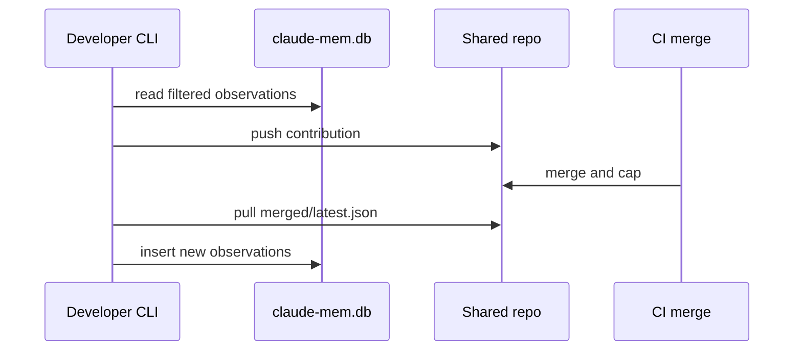

# Export and Import

## Motivazione

Export and import are explicit so developers control what leaves and enters their local memory database.

::: steps
1. **Preview:** `mem-sync preview --project my-app`
2. **Export:** `mem-sync export --project my-app`
3. **Wait for CI:** confirm `merged/my-app/latest.json`
4. **Import:** `mem-sync import --project my-app`
:::

::: callout tip "First rollout"
Use `remote.autoMerge: false` until filters and review policy are validated.
:::

## Incremental export

Each export compares your filtered observations with everything the shared repo already holds (all contribution files plus `merged/<project>/latest.json`) and writes only the new ones. If nothing is new, no file and no commit is created, so scheduled hourly exports stay quiet.

Your own contribution files that CI has already merged are compacted into a single deduplicated file during export, in the same commit.

To clean up contribution files committed before this behaviour existed, run `mem-sync compact --project my-app` (add `--dry-run` to preview). It merges all of your files for the project into one and requires `remote.autoMerge: true`.

::: callout note "Attribution"
Compaction works per developer, so `exportedBy` stays accurate. Observations that several developers share are skipped on export once any contribution holds them.
:::
